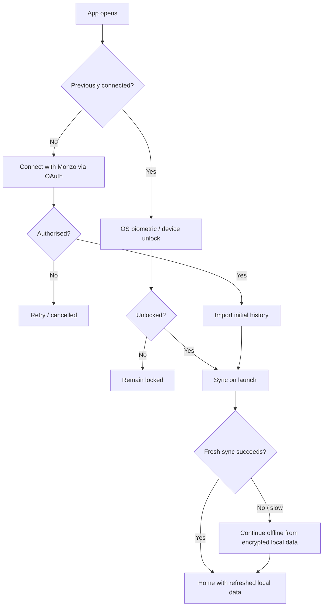

# Startup, Unlock and Synchronisation — Functional Specification

**Status:** Draft — agreed V1 experience  
**Document ID:** PAGE-STARTUP-FUNCTIONAL  
**Version:** 0.1  
**Release:** V1

## Purpose and authority

Startup answers **"Can I securely open Vibe Ledger, and are my financial records up to date?"**. It is an app-entry flow, **not a separate Vibe Ledger user-account system**. Monzo authorises read access to bank data; local device authentication unlocks locally stored Vibe Ledger data. Never conflate them.

This file owns startup screens, loading/skip/offline/reconnect states, session navigation and the transition into Home. [Settings](../settings/FUNCTIONAL.md) owns on-demand connection/sync controls. [Local Data Architecture](../../06-engineering/LOCAL_DATA_ARCHITECTURE.md) owns sync scheduling, storage, token/key isolation and lifecycle. [Monzo Integration](../../MONZO_INTEGRATION.md) owns API and OAuth constraints. [Design Philosophy](../../01-philosophy/DESIGN_PHILOSOPHY.md) owns overall interaction values.

## START-001 — First launch / first bank connection

A lightweight Vibe Ledger welcome/initial-loading experience leads into **Connect with Monzo**. The app uses Monzo's real OAuth authorisation flow; there is no Vibe Ledger username/password and no fake in-app copy of Monzo's sign-in screen.

**Acceptance criteria**
- New installation explains that Monzo connection is required to import real transactions, without presenting a fictitious Vibe Ledger account registration.
- User is redirected to Monzo's supported authorisation experience and securely returned to Vibe Ledger on success.
- Monzo may require browser/email sign-in plus approval within its app; already signed-in Monzo users are not promised a zero-interaction login.
- Canceled/denied/failed consent is handled without showing a falsely connected state.
- The app checks authorisation is actually usable before importing real financial data.
- Once authorised, initial history import starts promptly; until initial history is complete the UI accurately reports partial coverage.
- Failure during setup permits safe Retry and does not lose locally confirmed settings.

## START-002 — Subsequent launch and biometric unlock

On a previously configured installation: short branded loading/splash, then an **OS-provided device-authentication prompt** (fingerprint/Face ID where supported; secure device credential fallback as appropriate). Only after successful unlock may sensitive local data be displayed.

**Acceptance criteria**
- Biometric authentication is for Vibe Ledger access, separate from Monzo OAuth.
- Failure/cancellation does not expose decrypted financial information, stale app preview frames or navigation behind the lock.
- If biometrics are unavailable or changed, follow an explicit secure device-credential/recovery path; never silently disable protection.
- Successful local unlock must **not** trigger Monzo OAuth again unless credentials actually need reauthorisation.
- Return from background respects the existing local session; after expiry the user must unlock again.
- System app-switcher thumbnails/background state conceal financial amounts.

## START-003 — Sync on every launch

After local unlock, **attempt to synchronise Monzo on every launch**, so each successful launch refreshes the current financial view. This does **not** mean re-downloading all historical transactions or clearing the database. All available authorised Monzo accounts and pots are included for V1; there is no account inclusion selector.

**Acceptance criteria**
- Show a restrained, legible syncing state; users know whether data is current or locally cached.
- Once sync succeeds, Home/Breakdown/Trends read the updated local database and present consistent amounts.
- Previously imported encrypted history remains usable while fresh data is fetched; a slow sync must not indefinitely block Home.
- Repeat foreground entries may sync when appropriate; simultaneous sync attempts are coalesced, never duplicated.
- Manual Sync Now in Settings invokes the **same synchronisation pipeline**.
- V1 does not require a hosted Vibe Ledger backend, webhooks, push jobs or continuous background execution.

## START-004 — Offline and Skip

If internet is missing, the API is unavailable, or sync is slow, offer **Continue offline** (or Skip) and open the last committed local dataset after local unlock.

**Acceptance criteria**
- Offline mode is visibly but unobtrusively labelled with last successful sync time and coverage if known.
- The app never labels offline data as freshly synchronised.
- When there is no local data yet, Continue offline cannot invent financial history; provide Retry or a clearly empty/demo state where appropriate.
- A recoverable sync failure does not erase historical data or local classification edits.
- Connecting again later can reconcile data without duplicate transactions.

## START-005 — Reconnect and expired Monzo authorisation

When the access token is invalid or the user revoked permission, show **Reconnect with Monzo**. The app unlocks its own local archive independently of bank-token validity.

**Acceptance criteria**
- Reconnect launches genuine Monzo OAuth, never requests bank credentials inside Vibe Ledger.
- Unsupported automatic token refresh is not attempted for public/non-confidential native clients; user-driven reauthorisation is an accepted no-backend V1 limitation.
- Failure to reauthorise does not erase the encrypted local historical archive.
- Bank-auth problems are distinguishable from connectivity or rate-limit errors.
- Monzo's transaction-history restriction is respected: initial comprehensive import must take place promptly during the fresh authorisation window.

## START-006 — Lock and one-hour inactivity expiry

V1 maintains a protected local session and encrypted persistent historical database. After **one hour without active use**, the session expires. Sensitive temporary buffers, unencrypted temporary files and derived working caches are cleared as far as platform/runtime capabilities permit.

**Acceptance criteria**
- Expiry invalidates access to financial UI and requires device authentication to resume.
- The encrypted historical archive, app-owned category mappings and period definitions are **not destroyed** on routine inactivity in V1.
- An inactivity deadline is enforced **on return to foreground and before displaying sensitive data**, not dependent on exact background timer execution.
- App switcher/background UI shields sensitive content immediately.
- Do not claim that managed Dart heap or GPU/rendering memory has been physically zeroised.
- Advanced low-level zeroisation, optional ephemeral full-history deletion and key destruction are **future phases** with separate threat modelling and tests.

## START-007 — Honest status and accessibility

Startup remains fast, understandable and accessible.

**Acceptance criteria**
- Loading, network progress, offline fallback and permission-denied states have accessible labels.
- Splash and animations do not imply a long, unnecessary login sequence.
- Device-auth fallback and Retry/Continue offline are operable with accessible touch/focus controls.
- No fake success state, fake progress percentage or unsupported promise of Monzo app-to-app silent sign-in.

## State flow (illustrative)

**Implementation handoff:** API handling, data and secure-storage behaviours are owned by [Local Data Architecture](../../06-engineering/LOCAL_DATA_ARCHITECTURE.md). Authentication provider and plugin feasibility need an early working prototype before promising uninterrupted OAuth.

<!-- GENERATED: BACKLINKS START -->
## Used by

- [docs/00-workflow/OWNERSHIP_MAP.md](<../../00-workflow/OWNERSHIP_MAP.md>)
- [docs/05-pages/settings/FUNCTIONAL.md](<../settings/FUNCTIONAL.md>)
- [docs/06-engineering/LOCAL_DATA_ARCHITECTURE.md](<../../06-engineering/LOCAL_DATA_ARCHITECTURE.md>)
- [docs/MONZO_INTEGRATION.md](<../../MONZO_INTEGRATION.md>)
- [docs/PRODUCT_SPEC.md](<../../PRODUCT_SPEC.md>)
<!-- GENERATED: BACKLINKS END -->
