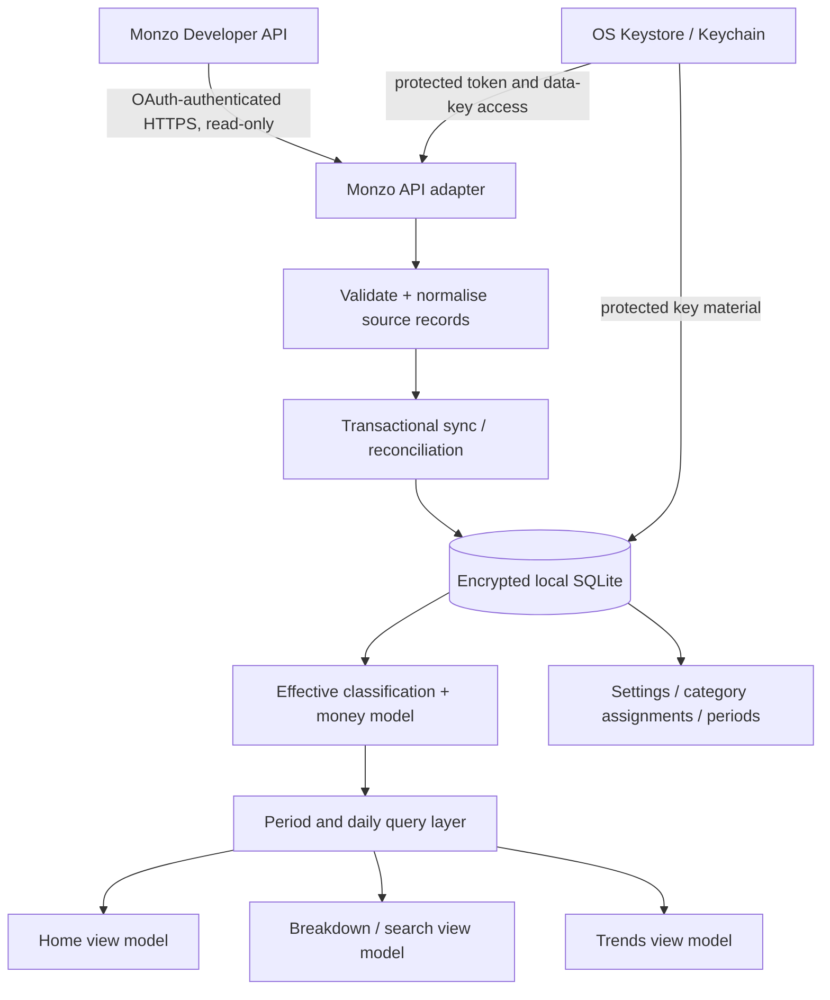

# Vibe Ledger — Local Data Architecture and Monzo Sync

**Status:** Draft — V1 implementation handoff, API verification required  
**Document ID:** ENG-LOCAL-DATA-ARCH  
**Version:** 0.1

## 1. Architecture boundary

**V1 has no hosted Vibe Ledger backend.** The "backend" is a set of **on-device repositories, synchronisation services, classification logic and an encrypted SQLite database** inside the Flutter application. GitHub stores source code and documentation; **Monzo** is the banking-data source.



No webhook receiver, analytics server, app login account server, third-party telemetry store or remote Vibe Ledger database in V1. Do **not** confuse a local SQLite database with a hosted backend.

**Source-of-truth boundaries**
- [Monzo Integration](../MONZO_INTEGRATION.md) owns API/auth details and their limitations.
- [Data Model](../DATA_MODEL.md) owns logical persisted entities and migrations.
- [Money Model](../MONEY_MODEL.md) owns financial meanings and classification precedence.
- [Budget Periods](../02-product/BUDGET_PERIODS.md) owns payday-based boundaries.
- [Startup](../05-pages/startup/FUNCTIONAL.md) and [Settings](../05-pages/settings/FUNCTIONAL.md) own user-visible flows.
- [Home](../05-pages/home/FUNCTIONAL.md), [Breakdown](../05-pages/breakdown/FUNCTIONAL.md) and [Trends](../05-pages/trends/FUNCTIONAL.md) consume local query results; they must **not** separately calculate event semantics.

## 2. Data received from Monzo

The V1 adapter is **read-only**. Monzo Developer API documentation: https://docs.monzo.com/

| Endpoint | Relevant documented fields | Use |
| --- | --- | --- |
| `GET /accounts` | `accounts[].id`, `description`, `created` | Discover all accessible accounts; stable source IDs |
| `GET /pots?current_account_id=...` | `pots[].id`, `name`, `style`, `balance`, `currency`, `created`, `updated`, `deleted` | Discover pot identities, metadata and latest **snapshot**, not a complete historical savings valuation |
| `GET /transactions?account_id=...` | `transactions[].id`, `amount`, `currency`, `description`, `created`, `settled`, `category`, `merchant`, `metadata`, `notes`, `is_load`; optional status/decline fields | Primary raw financial-event history |
| `GET /transactions/{id}?expand[]=merchant` or expanded listing where supported | `merchant.id`, `name`, `logo`, `emoji`, `category`, optional address | Optional merchant enrichment without inventing category-specific icons |

**Important distinctions**
- Amounts are signed **integer minor units** in the supplied currency; a negative debit is **not always** a Vibe Ledger `SPEND`.
- A transaction's `category` is a source key such as `eating_out`; it is **not** a super-category or a category colour/icon payload.
- Merchant `logo`/`emoji` are **merchant properties**, not category branding.
- Pots expose current balance snapshots, but that does not prove Vibe Ledger knows all savings across external providers, interest or investment returns.
- Source response fields can be missing or evolve; the adapter validates types, preserves unknown category keys for review, and must never infer unspecified categories.
- The public Developer API is limited to the developer's own account or a small expressly permitted user set. A public app would require an appropriate regulated Open Banking integration.
- V1 covers **all accessible Monzo accounts and pots**; no per-account exclusion UI. A pot does not necessarily expose an independently complete transaction ledger through the accounts transaction endpoint; reconcile what is actually observable and signal gaps.

## 3. End-to-end write path

### ENG-DATA-001 — Authenticated read-only ingestion

**Acceptance criteria**
- Use Monzo OAuth access granted by the user. Never ask the app to collect Monzo passwords, log tokens or embed a confidential client secret in a public app binary.
- Discover all accessible accounts and pots. Fetch transactions **per account**, with pagination (`limit`, `since`, `before` as supported), and merchant expansion as needed.
- Preserve original `id`, `account_id`, timestamps, signed amount and currency before any UI conversion.
- The import only calls read endpoints, never Monzo's payment/pot-deposit/withdrawal/annotation mutation routes.
- Malformed or unknown records are quarantined/reportable rather than silently misclassified or dropped.

### ENG-DATA-002 — One-time history import and repeat sync

Monzo documents that full-history transaction access is available immediately after strong authentication and that, **after five minutes**, accessible sync history is limited to the **last 90 days**.

**Acceptance criteria**
- On first connection / fresh reauthorisation, start paginating historical transactions **immediately**, across every accessible account; record completeness **per account**. If the time window expires before completion, mark older coverage partial and offer a fresh authentication/retry strategy.
- On **every subsequent launch**, attempt an incremental/reconciliation fetch of recent transactions, not a destructive "download entire history" operation.
- Include a modest, configurable overlap within the permitted lookback to detect changed metadata, unsettled→settled transitions, corrections and newly arrived older-posted events.
- A single synchronisation coordinator prevents duplicate concurrent jobs (launch + Sync Now).
- Respect API failures, `429` with backoff, network timeouts and revoked/expired access; retain committed historical data.
- **Never purge the sole local copy of historical transactions on routine cache expiry.**
- Do not claim that missing remote records during a partial response were deleted from Monzo. Deletion/reversal reconciliation requires positive evidence.

### ENG-DATA-003 — Normalisation and atomic persistence

Data flow:

```text
API JSON
  → transport/schema validation
  → normalise field types and UTC times
  → UPSERT raw source records by (source, source_transaction_id)
  → maintain account/pot/merchant references
  → recompute affected effective classifications and aggregates
  → commit local DB transaction
  → notify page repositories / view models
```

**Acceptance criteria**
- Repeating an import does **not** duplicate a transaction or split its value across queries.
- Preserve local manual classification/notes/splits when remote description, merchant or category is updated.
- Source record revisions update original source fields and `last_synced_at`, never overwrite user-owned data.
- Page readers see a committed and coherent snapshot; failure halfway through a page/job doesn't expose half a financial total.
- Store `initial_history_complete`, last successful/attempted sync, last error, coverage window and per-account cursor/checkpoint. Do not mistake `latest_seen_transaction_time` alone for complete history.
- Make sync logic testable using fixed Monzo JSON fixtures; network adapter and local DB should be independently mockable.

## 4. Local persistent storage contract

The exact schema, keys and migrations belong to the [Data Model](../DATA_MODEL.md); this table describes the **information families and their ownership**, not a second independent schema.

| Data family | Store persistently? | Notes |
| --- | --- | --- |
| Source accounts and pot metadata | Yes | Stable IDs and latest observed snapshots; don't equate with full financial wealth |
| Raw imported transactions | Yes | Source identity, signed minor-unit amount, currency, UTC created/settled, Monzo category key, description/merchant, source sync metadata; optional raw payload retained only when justified |
| User event classification/splits | Yes | Event type, INCLUDED/EXCLUDED, category, confidence, manual override and split portions; never rewrite source amount |
| Source category → super-category mapping | Yes | Unassigned state; Living/Saving/Fun assignment; explicit overrides take precedence |
| Category appearance | Yes | Icon; start/end gradient colour; stable category ID and source label |
| Theme choice | Yes | Selected curated preset ID; derived rendering tokens are not transactional records |
| Budget period rule and periods | Yes | Start day 1–31, effective-date/version, explicit period boundaries and historical allocations/targets |
| Subscriptions and classification rules | Yes | As separately defined by money/data model; not user-editable inside Settings' category sorting game |
| Sync status / import coverage | Yes | Per source/account status, cursors, errors, last durable sync |
| OAuth access tokens | **Separate secure OS storage** | Never in ordinary SQLite or logs; exact expiry and revoke state tracked safely |
| Decrypted results / temporary API bodies | Only briefly | In-memory/session working data; clear caches on lock; no decrypted disk/temp copies |
| Merchant logos / optional media cache | Optional | Avoid storing images or addresses when not needed; cache with bounded policy |

**Encryption:** use an authenticated encrypted database solution suitable for Flutter/SQLite (e.g. a vetted SQLCipher integration), with keys and tokens protected by Android Keystore / iOS Keychain or equivalent. An ordinary SQLite file behind a fingerprint overlay is **not encrypted storage**. Validate platform-backed key usability, backups, logout and recovery early; never assert secure enclave hardware guarantees without checking platform APIs.

Data is stored locally on-device. No Vibe Ledger cloud account is required in V1.

## 5. Effective model and read path

### ENG-DATA-004 — Query through a single financial domain layer

The reading contract is:

```text
DB immutable-ish raw events
  + app-owned classifications, user rules and split records
  + category → super-category mapping
  + budget-period boundaries and targets
  → effective transaction rows
  → daily/period category aggregates, saving contributions/withdrawals, coverage
  → UI view models
```

**Acceptance criteria**
- Home, Breakdown and Trends use the same effective-event computation. A savings transfer is never counted as consumption merely because the raw bank amount is negative.
- Manual per-transaction override outranks classification rules and imported Monzo hints, following the [Money Model](../MONEY_MODEL.md).
- Splits contribute only their child portions to totals; parent amounts are not counted again.
- Refund/reimbursement offsets, excluded records and neutral transfers are handled consistently.
- Unknown event type/category mapping is explicitly tracked as **Needs Review** and incomplete coverage, rather than silently treated as zero spend.
- Read models include a data-freshness/coverage flag; a missing range and an actual zero must not be indistinguishable.

### ENG-DATA-005 — Example read APIs / repository interfaces

These are **illustrative Dart repository interfaces**, not mandatory class/field names:

```dart
abstract interface class FinanceRepository {
  Stream<HomeSnapshot> watchHome(BudgetPeriodId period);
  Stream<BreakdownSnapshot> watchBreakdown(BreakdownQuery query);
  Stream<TrendsSnapshot> watchTrends(TrendsQuery query);
  Future<TransactionDetails?> getTransaction(SourceTransactionKey key);
  Stream<ClassificationReview> watchNeedsReview();
}

abstract interface class SyncRepository {
  Stream<SyncState> watchSyncState();
  Future<SyncResult> syncAllAvailableMonzoAccounts();
}
```

Trends query parameters include selected date range, super-category/category scope and optional selected day. Aggregations use the actual chosen local period/day boundaries, not a blanket `strftime('%Y-%m')` calendar-month grouping.

**Acceptance criteria**
- Views respond to committed DB changes and classification edits without requiring another HTTP call.
- No UI component directly parses Monzo API JSON or calculates its own financial meaning.
- Parameterised queries/indexes support transaction ID, account ID, created date, category, event type, and indexed searchable description/merchant.
- Transaction search is performed locally; no raw financial data is sent to an external text search or AI service.
- Date and currency arithmetic are precise; **do not combine distinct currencies without an explicitly defined FX policy**.

### ENG-DATA-006 — Representative report queries

The following pseudocode illustrates the distinction between raw transactions, **effective classified portions**, and aggregates (it is not a second normative money formula):

```sql
-- Contract: effective_events is produced according to MONEY_MODEL.md.
-- amount_minor_signed here is a UI-independent financial amount.
SELECT local_day, super_category_key, SUM(activity_minor) AS total_minor
FROM effective_activity
WHERE local_day >= :from_date
  AND local_day <  :to_date_exclusive
  AND included = 1
GROUP BY local_day, super_category_key
ORDER BY local_day, super_category_key;

SELECT category_id, SUM(activity_minor) AS total_minor
FROM effective_activity
WHERE local_day = :selected_day
  AND super_category_key = :scope
  AND included = 1
GROUP BY category_id
ORDER BY total_minor DESC, category_id;
```

The implementation must specify how `activity_minor` is populated for each type: **Living/Fun net spend versus Saving gross contributions**, while storing withdrawals separately for net-saved metrics.

## 6. Classification and colour mapping

### ENG-DATA-007 — Imported categories are hints; Vibe Ledger owns meaning

**Acceptance criteria**
- Imported Monzo category keys are normalised to a stable local identity and presented with readable labels; unfamiliar keys are retained.
- Each imported category may be mapped to Living, Fun, Saving or left Unassigned; user choices persist across syncs and update matching historical aggregates.
- User-specific icon and gradient endpoints belong to local category settings, not Monzo's API.
- The classification engine identifies saving contributions, saving withdrawals, transfers, income and spend independently of raw debit/credit signs.
- Transfers between the user's own imported accounts/pots require deduplication/linking where possible, so the source and destination legs don't create fictional income/spending.
- A category-level mapping is not a substitute for **per-transaction type/destination handling**; savings pots, Moneybox transfers and unusual transactions require explicit classification or review.
- Don't assume the Monzo public API returns all custom category information or transaction history for pots without testing representative real responses.

## 7. Security and lifecycle

### ENG-DATA-008 — Protected local session, encrypted archive

**Acceptance criteria**
- Authentication uses OS biometric/device credentials; raw financial records are not shown behind an unlocked-looking screen.
- Financial database is encrypted at rest using a well-reviewed implementation; key availability is bound to protected application access per tested platform capabilities.
- Background snapshots conceal amounts; logs, crash events, stack traces and analytics do not include raw balances, transaction descriptions, payloads or tokens.
- Temporary decrypted caches are discarded when the V1 session expires after **one hour of inactivity**. The encrypted local archive is retained for historical Trends and offline access.
- Startup verifies session expiry before reading sensitive data, not via an unreliable precisely timed background task.
- On user-initiated local deletion/disconnect, distinguish **token removal**, **local archive removal** and **cryptographic key destruction**, each with its proper user-facing confirmation.
- Native memory zeroisation, ephemeral history storage and more aggressive deletion are deferred to a separate security phase, not misrepresented as V1 guarantees.

## 8. Test and delivery plan

### ENG-DATA-009 — Demonstrate correctness with fixtures first

Required test fixtures / acceptance checks:
1. Two imported accounts with opposite sides of a transfer: only one financial effect, no duplicate income.
2. Saving contribution to a Monzo pot and transfer to Moneybox: both Saving when properly classified; Moneybox transfer doesn't require a Moneybox API.
3. Successful initial full-history import, later incremental sync, replayed pages, a corrected merchant/category, and an interrupted sync recovered idempotently.
4. 5-minute initial-import limitation: incomplete historical coverage is surfaced, not silently declared complete.
5. An unknown category or uncertain event type is flagged, and a later user mapping updates Home/Breakdown/Trends consistently.
6. A manual transaction override survives subsequent re-imports and never mutates the source payload.
7. Budget periods with 25th and 31st starts across February, leap years and daylight-saving dates.
8. Offline launch, expired Monzo token, rate-limited sync, and revoked consent preserve the encrypted archive and show honest status.
9. Duplicate source transaction, split transaction, refunds and reimbursements reconcile at all three page levels.
10. Locally encrypted file is unreadable without the key; secrets and sensitive payloads absent from logs/backups in configured secure modes.

**Implementation sequence:** fixture-based local DB and domain engine → Monzo OAuth/adapter proof of concept → initial import + recovery → incremental sync → reactive page queries → encryption/key hardening + device lock → end-to-end verification.

## 9. Unresolved feasibility/migration decisions

- **Native OAuth feasibility without a hosted confidential client:** Monzo's documented authorisation-code exchange uses a `client_secret`, while **non-confidential clients are not issued refresh tokens**. Do a real native Flutter proof of concept; do not ship an embedded secret or pretend uninterrupted long-lived sessions are guaranteed. Public launch is outside Developer API scope.
- **Historical data availability:** validate full import across multiple accounts inside Monzo's post-authentication window, and precise rules for amended/reversed data.
- **Pots:** verify observable transfer events and source/destination links against real payloads; do not double-count or invent coverage.
- **Encrypted SQLite adapter/OS key integration:** evaluate library maintenance, platform support, testability, backup policy and rekey failure recovery.
- **Schema migration:** legacy `monthly_budgets` and view names must migrate to actual `budget_periods` (see [Budget Periods](../02-product/BUDGET_PERIODS.md)); category appearance and source category mapping must be persisted without duplicating ownership of financial meaning.
- **Category granularity:** Monzo's standard category key may be coarser than requested user-defined categories. Decide how to expose custom categories/saving-pot classifications without pretending Monzo has supplied that granularity.
- **Timeout policy detail:** one hour of inactivity is the agreed V1 session rule; encryption-key locking, OS background lifecycle and recovery must be empirically tested.
- **Design-system visual contract** remains deferred until Figma.

<!-- GENERATED: BACKLINKS START -->
## Used by

- [docs/00-workflow/OWNERSHIP_MAP.md](<../00-workflow/OWNERSHIP_MAP.md>)
- [docs/05-pages/settings/FUNCTIONAL.md](<../05-pages/settings/FUNCTIONAL.md>)
- [docs/05-pages/startup/FUNCTIONAL.md](<../05-pages/startup/FUNCTIONAL.md>)
- [docs/MONZO_INTEGRATION.md](<../MONZO_INTEGRATION.md>)
- [docs/PRODUCT_SPEC.md](<../PRODUCT_SPEC.md>)
<!-- GENERATED: BACKLINKS END -->
